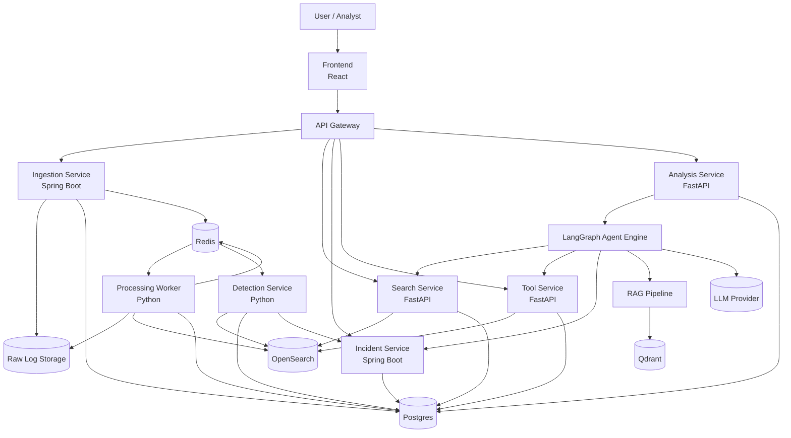
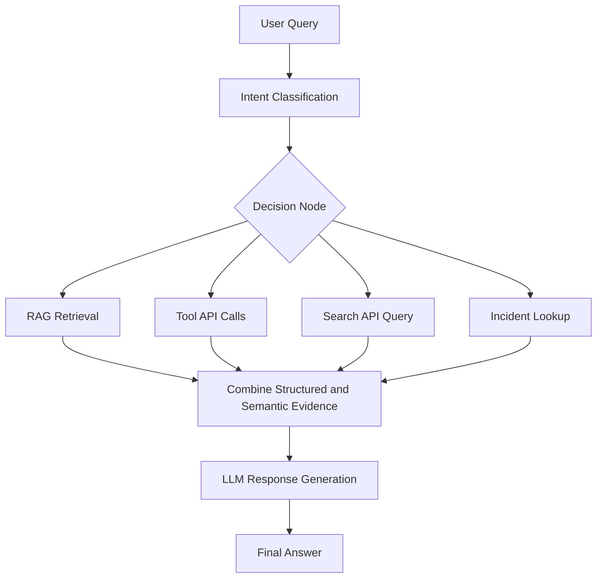

s# AI-Powered Log Intelligence Platform with RAG and LangGraph Agents

## 1. Objective

Build a microservices-based platform that can:

- ingest and analyze logs
- detect incidents and anomalies
- support structured operational search with OpenSearch
- retrieve historical and knowledge context through RAG
- use LangGraph agent workflows for intelligent multi-step reasoning

The platform is a hybrid system:

- a deterministic backend for logs, detections, and incidents
- an AI layer for retrieval, reasoning, summarization, and guided triage

The platform must remain operational even when the AI layer is unavailable. AI augments the system; it does not replace core search, ingestion, or incident workflows.

---

## 2. Core Architecture Principles

1. **Logs first, AI second**  
   Log ingestion, parsing, search, and incident workflows must work without LLM access.

2. **OpenSearch is the primary log engine**  
   Logs are event data and require exact filters, aggregations, and time-based queries.

3. **RAG is for knowledge and history, not raw operational log storage**  
   Qdrant stores embeddings for incident summaries, runbooks, past issues, and log summaries.

4. **LangGraph orchestrates multi-step reasoning**  
   The agent layer decides when to call tools, search structured logs, and retrieve semantic context before generating an answer.

5. **Structured tools are first-class**  
   Investigation actions must be explicit, auditable, and API-driven.

6. **Async ingestion is required**  
   Upload latency must be decoupled from parsing, indexing, and detection.

---

## 3. Layered Architecture

### 3.1 Experience Layer

- React frontend
- API Gateway

### 3.2 Core Services Layer

- Ingestion Service
- Search Service
- Incident Service
- Tool Service
- Detection Service

### 3.3 AI Layer

- Analysis Service
- RAG Pipeline
- LangGraph Agent Engine

### 3.4 Data Layer

- OpenSearch for normalized logs
- Postgres for metadata and workflow state
- Redis for async jobs and coordination
- Qdrant for vector retrieval
- Raw file storage for uploaded log files

---

## 4. High-Level Architecture Diagram



---

## 5. Service Responsibilities

## 5.1 Frontend

Responsibilities:

- upload log files
- search and filter logs
- inspect incidents and findings
- submit natural-language analysis queries
- display RAG-backed and agent-backed responses
- optionally support chat-style investigation flows and SSE streaming

Suggested stack:

- React
- TypeScript
- Vite

## 5.2 API Gateway

Responsibilities:

- single public entrypoint
- route forwarding
- auth propagation
- future rate limiting and API shaping

Public route groups:

- `/api/ingestion/*`
- `/api/search/*`
- `/api/incidents/*`
- `/api/rag/*`
- `/api/analysis/*`
- `/tools/*`

## 5.3 Ingestion Service

Responsibilities:

- accept uploads in JSON, text, and CSV
- validate file type and metadata
- store raw log files
- create ingestion jobs
- publish processing jobs to Redis

Suggested stack:

- Spring Boot
- Postgres
- Redis
- local file storage or S3-compatible storage

## 5.4 Processing Worker

Responsibilities:

- consume ingestion jobs
- parse raw log files
- normalize records into a common log schema
- enrich extracted fields
- write searchable events to OpenSearch
- update job status in Postgres
- enqueue detection work
- optionally generate log summaries for RAG indexing

Suggested stack:

- Python
- Redis worker loop, Celery, or RQ

## 5.5 Search Service

Responsibilities:

- query normalized logs from OpenSearch
- support filters by time range, service, and log level
- support aggregations such as error count and service breakdown
- provide trace and time-window lookup support for tools and agents

Suggested stack:

- FastAPI
- OpenSearch client

## 5.6 Detection Service

Responsibilities:

- run rule-based detections
- identify error spikes and elevated 5xx rates
- create findings records
- initiate or suggest incident creation

Representative v1 detections:

- error spikes over baseline
- high 5xx rate by service
- repeated exception bursts

## 5.7 Incident Service

Responsibilities:

- create incidents from detections or analyst actions
- manage incident lifecycle
- store notes, timestamps, and related findings
- expose incident history for human review and AI retrieval

Suggested states:

- `OPEN`
- `RESOLVED`

Future states can expand later without changing the initial contract.

## 5.8 Tool Service

Responsibilities:

- expose structured investigation APIs used by LangGraph
- validate tool input/output contracts
- log tool usage for auditing and debugging
- provide deterministic evidence to the analysis layer

Required tools:

- `GET /tools/top-errors`
- `GET /tools/service-error-rate`
- `POST /tools/time-comparison`
- `GET /tools/trace/{id}`

## 5.9 Analysis Service

Responsibilities:

- accept analyst questions
- invoke the LangGraph agent workflow
- collect structured and semantic evidence
- generate a final answer with sources and tool traces
- optionally stream responses to the UI

Suggested stack:

- FastAPI
- LangGraph
- provider adapter for OpenAI, Gemini, or local LLMs

## 5.10 RAG Pipeline

Responsibilities:

- chunk and embed knowledge documents
- store embeddings in Qdrant
- retrieve relevant context for user questions
- return grounded evidence to the LLM and agent layer

Knowledge corpus for Qdrant:

- incident summaries
- log summaries
- runbooks
- past issues

## 5.11 LangGraph Agent Engine

Responsibilities:

- classify user intent
- decide which data sources to use
- execute multi-step workflows across search, tool APIs, and RAG
- combine evidence into a single grounded response

The agent must be able to:

- decide whether to use RAG
- call one or more tool APIs
- query structured logs through the Search Service
- combine structured and semantic results in one answer

---

## 6. Data Ownership and Storage Boundaries

## 6.1 OpenSearch

Primary store for operational log events.

Use OpenSearch for:

- raw and normalized log search
- time range filtering
- service and level filters
- exact field lookup
- aggregations and drilldowns
- incident investigation pivots

OpenSearch is not replaced by Qdrant.

## 6.2 Postgres

System of record for transactional and workflow data.

Store:

- ingestion jobs
- upload metadata
- detections metadata
- findings
- incidents
- incident notes
- analysis request history
- tool execution logs

## 6.3 Redis

Async coordination layer.

Use Redis for:

- ingestion job queue
- parsing/indexing jobs
- detection jobs
- retries and lightweight workflow handoff

## 6.4 Qdrant

Semantic memory layer for RAG.

Store embeddings for:

- incident summaries
- log summaries
- runbooks
- past issues

Qdrant is only used for knowledge retrieval, semantic similarity, and historical context lookup.

## 6.5 Raw Log Storage

Use local filesystem or S3-compatible object storage for:

- uploaded source files
- archival inputs
- reprocessing inputs

---

## 7. Public APIs

## 7.1 Ingestion API

### `POST /api/ingestion/upload`

Purpose:

- upload a log file and create an ingestion job

Request:

- multipart file upload
- optional metadata such as source name, service, environment, and format hint

Response:

```json
{
  "jobId": "job_123",
  "status": "QUEUED",
  "fileName": "payment-errors.csv",
  "receivedAt": "2026-03-31T10:00:00Z"
}
```

## 7.2 Search API

### `GET /api/search`

Purpose:

- search normalized logs with exact filters and time constraints

Representative query parameters:

- `service`
- `level`
- `from`
- `to`
- `traceId`
- `page`
- `size`

Example:

- `GET /api/search?service=payment&level=ERROR`

Response:

```json
{
  "items": [],
  "aggregations": {
    "errorCount": 42,
    "serviceBreakdown": [
      { "service": "payment", "count": 42 }
    ]
  },
  "page": 0,
  "size": 50,
  "total": 42
}
```

## 7.3 Incident API

### `POST /api/incidents`

Purpose:

- create an incident from detections or manual analyst action

Request:

```json
{
  "title": "Payment service elevated 5xx errors",
  "status": "OPEN",
  "notes": "Created from detection engine",
  "findingIds": ["finding_001", "finding_002"]
}
```

### `GET /api/incidents/{id}`

Purpose:

- fetch incident details, notes, status, and related findings

Response:

```json
{
  "id": "inc_001",
  "title": "Payment service elevated 5xx errors",
  "status": "OPEN",
  "notes": [
    {
      "id": "note_01",
      "text": "Initial triage started",
      "createdAt": "2026-03-31T10:15:00Z"
    }
  ],
  "findingIds": ["finding_001", "finding_002"],
  "createdAt": "2026-03-31T10:12:00Z",
  "resolvedAt": null
}
```

## 7.4 RAG API

### `POST /api/rag/query`

Purpose:

- retrieve semantic context from Qdrant-backed knowledge sources and generate a grounded answer

Request:

```json
{
  "query": "Have we seen this database timeout issue before?",
  "topK": 5
}
```

Response:

```json
{
  "answer": "A similar timeout pattern was seen in a prior payment incident linked to connection pool exhaustion.",
  "sources": [
    {
      "id": "incident_summary_42",
      "type": "incident_summary",
      "title": "Payment DB timeout on peak traffic",
      "score": 0.91
    }
  ]
}
```

## 7.5 Analysis API

### `POST /api/analysis/query`

Purpose:

- run the LangGraph workflow for multi-step reasoning over logs, tools, incidents, and RAG sources

Request:

```json
{
  "question": "Why did payment service fail yesterday?",
  "timeRange": {
    "from": "2026-03-30T00:00:00Z",
    "to": "2026-03-30T23:59:59Z"
  },
  "service": "payment"
}
```

Response:

```json
{
  "answer": "Payment failures increased after a spike in downstream 502 responses. Similar incidents indicate a retry storm triggered by gateway saturation.",
  "toolCalls": [
    { "name": "service-error-rate", "status": "SUCCESS" },
    { "name": "top-errors", "status": "SUCCESS" }
  ],
  "sources": [
    { "type": "search", "ref": "trace_id=abc123" },
    { "type": "rag", "ref": "incident_summary_42" }
  ],
  "finalIntent": "ROOT_CAUSE_ANALYSIS"
}
```

---

## 8. Tool Contracts

## 8.1 `GET /tools/top-errors`

Purpose:

- return most frequent error signatures in a time window and optional service scope

Representative response:

```json
{
  "items": [
    {
      "message": "Database timeout",
      "count": 87,
      "service": "payment"
    }
  ]
}
```

## 8.2 `GET /tools/service-error-rate`

Purpose:

- compute error rate for one or more services over a time window

Representative response:

```json
{
  "service": "payment",
  "errorRate": 0.18,
  "errorCount": 87,
  "totalRequests": 483
}
```

## 8.3 `POST /tools/time-comparison`

Purpose:

- compare metrics or error behavior across two time windows

Representative request:

```json
{
  "service": "payment",
  "windowA": {
    "from": "2026-03-30T09:00:00Z",
    "to": "2026-03-30T10:00:00Z"
  },
  "windowB": {
    "from": "2026-03-29T09:00:00Z",
    "to": "2026-03-29T10:00:00Z"
  }
}
```

## 8.4 `GET /tools/trace/{id}`

Purpose:

- fetch logs and correlated events for a trace or request path

Representative response:

```json
{
  "traceId": "abc123",
  "events": [],
  "services": ["gateway", "payment", "database-proxy"]
}
```

---

## 9. Key Domain Contracts

## 9.1 Normalized Log Event

All parsed logs should be normalized into a common shape before indexing into OpenSearch.

Representative fields:

```json
{
  "timestamp": "2026-03-31T10:00:00Z",
  "service": "payment",
  "environment": "prod",
  "level": "ERROR",
  "message": "Database timeout while charging order",
  "traceId": "abc123",
  "requestId": "req_456",
  "statusCode": 502,
  "host": "payment-7f6b7",
  "endpoint": "/payments/charge",
  "exceptionType": "TimeoutException",
  "tags": ["payments", "database"],
  "rawSource": "payment-errors.csv",
  "ingestedAt": "2026-03-31T10:00:05Z"
}
```

## 9.2 Incident Entity

Representative incident contract:

```json
{
  "id": "inc_001",
  "title": "Payment service elevated 5xx errors",
  "status": "OPEN",
  "notes": [
    {
      "id": "note_01",
      "text": "Monitoring increased 5xx rate after deployment",
      "createdAt": "2026-03-31T10:15:00Z"
    }
  ],
  "findingIds": ["finding_001", "finding_002"],
  "createdAt": "2026-03-31T10:12:00Z",
  "resolvedAt": null
}
```

## 9.3 RAG Response Contract

Minimum response contract:

```json
{
  "answer": "string",
  "sources": [
    {
      "id": "string",
      "type": "runbook | incident_summary | past_issue | log_summary",
      "title": "string",
      "score": 0.0
    }
  ]
}
```

## 9.4 Analysis Request and Response Contract

Minimum request:

```json
{
  "question": "string",
  "timeRange": {
    "from": "ISO-8601",
    "to": "ISO-8601"
  },
  "service": "string"
}
```

Minimum response:

```json
{
  "answer": "string",
  "toolCalls": [
    {
      "name": "string",
      "status": "SUCCESS | FAILED | SKIPPED"
    }
  ],
  "sources": [
    {
      "type": "search | rag | incident",
      "ref": "string"
    }
  ],
  "finalIntent": "string"
}
```

---

## 10. RAG Pipeline Design

## 10.1 Documents Indexed into Qdrant

The RAG pipeline indexes semantic knowledge, not raw log events.

Documents to embed:

- incident summaries
- log summaries
- runbooks
- past issue writeups

## 10.2 Indexing Flow

1. Source document is created or updated.
2. Content is normalized and chunked.
3. Each chunk is embedded.
4. Embeddings and metadata are stored in Qdrant.
5. Metadata includes source type, source id, title, timestamps, and tags.

## 10.3 Query Flow

1. User submits a question directly to `/api/rag/query` or indirectly through `/api/analysis/query`.
2. Query is embedded.
3. Qdrant similarity search retrieves top relevant chunks.
4. Retrieved context is assembled into grounded evidence.
5. LLM generates an answer from retrieved context.
6. Response returns both answer and sources.

---

## 11. LangGraph Agent Workflow

The LangGraph agent is the orchestration brain for multi-step reasoning.

### 11.1 Required Decision Logic

The agent should decide whether the user question requires:

- structured log search
- one or more tool calls
- semantic retrieval with RAG
- a combination of all three

### 11.2 Agent Flow Diagram



### 11.3 Example Intents

- root cause analysis
- similar issue lookup
- incident status lookup
- triage guidance
- service health comparison

### 11.4 Expected Agent Behavior

For a question like, "Why did payment service fail yesterday?", the agent should:

1. classify the question as root cause analysis
2. query structured logs from Search Service
3. call error-rate and top-error tools
4. fetch relevant incidents if available
5. retrieve similar past issues and runbooks through RAG
6. combine evidence
7. produce a grounded explanation

---

## 12. End-to-End Request Flows

## 12.1 Log Upload and Processing

1. User uploads log file through frontend.
2. Gateway forwards request to Ingestion Service.
3. Ingestion Service stores raw file and creates ingestion job.
4. Job is published to Redis.
5. Worker consumes job, parses records, and normalizes events.
6. Worker writes normalized events to OpenSearch.
7. Worker updates Postgres job status.
8. Worker publishes detection work.
9. Detection Service creates findings and may create incidents.

## 12.2 Root Cause Analysis

1. User asks, "Why did payment service fail yesterday?"
2. Analysis Service invokes LangGraph workflow.
3. Agent queries Search Service for payment errors in time window.
4. Agent calls `service-error-rate` and `top-errors`.
5. Agent retrieves similar incidents and runbooks through RAG.
6. LLM generates grounded explanation from combined evidence.
7. System returns answer, source references, and tool traces.

## 12.3 Similar Error Detection

1. User asks, "Have we seen this error before?"
2. Query is embedded and sent to Qdrant.
3. Similar incident summaries and past issues are retrieved.
4. Analysis Service returns semantic matches with source references.

## 12.4 AI Triage Guidance

1. User asks, "What should I do next?"
2. Agent retrieves incident context and current findings.
3. RAG fetches relevant runbooks.
4. LLM summarizes recommended next steps.

---

## 13. Current Repo Mapping and Recommended Evolution

This repository already contains:

- `apps/auth`
- `apps/document`
- `apps/frontend`
- `apps/gateway`
- `apps/query-service`
- `apps/worker-service`

Recommended evolution:

- `apps/document` becomes the ingestion-oriented service or is renamed to `apps/ingestion-service`
- `apps/query-service` evolves into the AI-facing analysis or RAG query boundary, depending on implementation preference
- `apps/worker-service` remains the async processing boundary for parsing, indexing, and downstream job publication
- new Python services are added for `search-service`, `tool-service`, `detection-service`, and a LangGraph-enabled analysis runtime if not merged into the existing query service
- existing `apps/auth` and `apps/gateway` remain valid supporting services

Recommended target layout:

```text
apps/
  auth/
  gateway/
  frontend/
  ingestion-service/
  worker-service/
  search-service/
  detection-service/
  incident-service/
  tool-service/
  analysis-service/
```

This evolution path preserves existing repo investments while aligning the codebase to the target log intelligence architecture.

---

## 14. Non-Functional Requirements

- The platform must degrade gracefully when the AI layer is disabled or unavailable.
- Core log ingestion and search must remain usable without Qdrant or LLM access.
- Tool execution must be auditable.
- Service interfaces should be explicit enough to support future polyglot implementation.
- Job handling should be idempotent where possible.
- The design should support future streaming ingestion without changing storage ownership assumptions.

---

## 15. Delivery Phases

## Phase 1 - Contracts and Foundations

- define normalized log schema
- define ingestion, search, incident, RAG, and analysis APIs
- establish service ownership and storage boundaries
- document tool contracts

## Phase 2 - Ingestion and Search MVP

- implement upload flow
- implement worker parsing and normalization
- index logs into OpenSearch
- expose search and aggregation APIs

## Phase 3 - Detection and Incident Management

- implement rule-based detections
- create findings pipeline
- add incident create and read APIs
- persist notes and lifecycle timestamps

## Phase 4 - RAG System

- build document chunking and embedding flow
- index incident summaries, runbooks, past issues, and log summaries into Qdrant
- expose `/api/rag/query`

## Phase 5 - LangGraph Agent Orchestration

- implement intent classification
- connect tool APIs, Search Service, Incident Service, and RAG into LangGraph
- expose `/api/analysis/query`
- return final grounded responses with evidence references

## Phase 6 - Optional Enhancements

- SSE streaming responses
- chat investigation UI
- detailed tool execution logs in frontend
- analyst feedback loop for agent improvement

---

## 16. Final Architecture Statement

This platform is a log-first microservices system where:

- OpenSearch is the operational engine for logs
- Postgres stores workflow and metadata state
- Redis coordinates asynchronous ingestion and detection work
- Qdrant provides semantic retrieval over historical and knowledge artifacts
- LangGraph orchestrates multi-step reasoning across structured search, deterministic tools, incidents, and RAG context

The result is an AI-powered log intelligence platform that stays operational without AI, while using RAG and LangGraph to improve accuracy, context, and triage effectiveness when AI capabilities are enabled.
